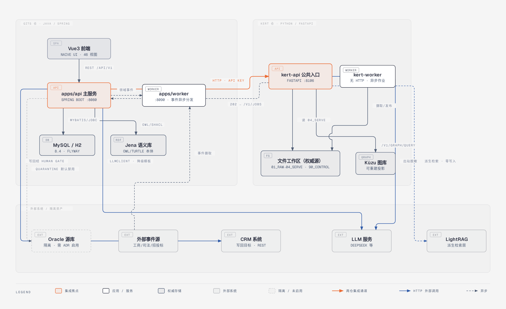
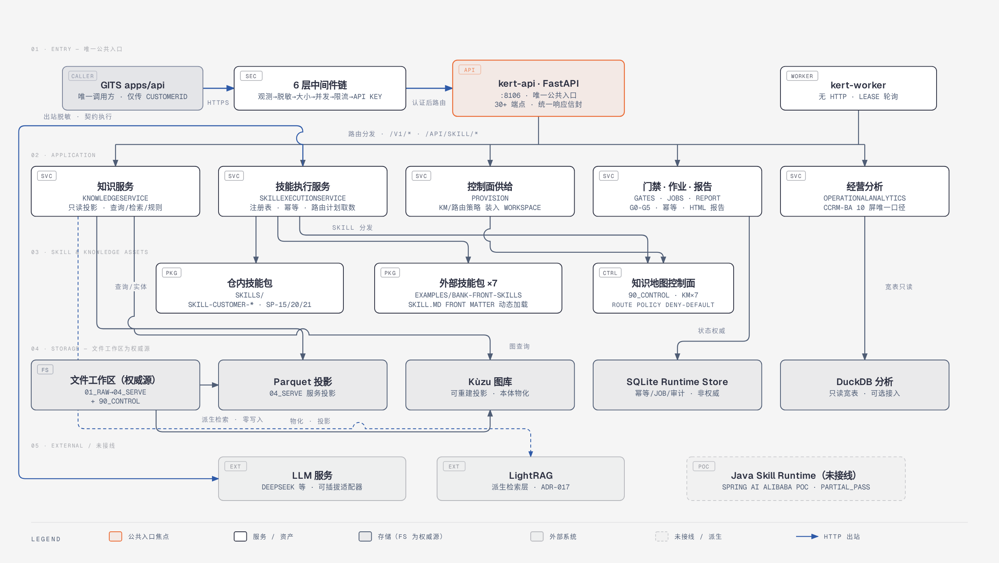
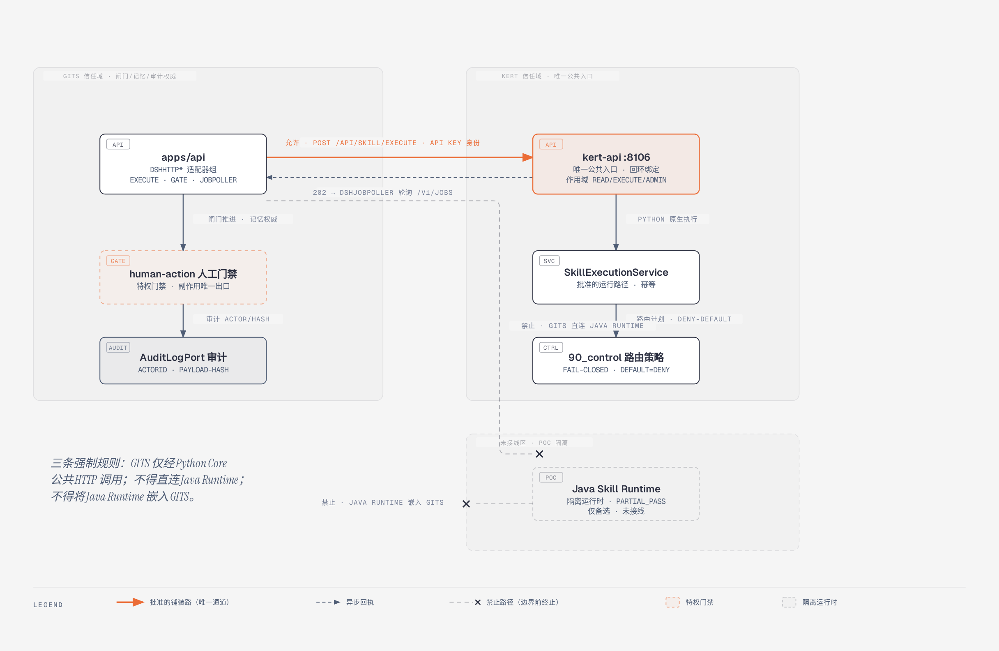

# KERT — 知识工程服务端（Python Core）

独立知识工程服务端，目标架构为 **C′ 混合架构**：

- **Python Core**：唯一公共入口、控制面、知识/数据权威源
- **Java Skill Runtime**：内部可替换执行器（当前仅 PoC，未接线）
- **GITS**：仅通过 Python Core 公共 HTTP 调用（`AGENTS.md` §3：GITS 不得直连 / 不得嵌入 Java Runtime）

当前处于 **M7 收口期**：M7.3 知识地图/路由治理（KnowledgeMapRegistry + RoutePolicy + ActivationPlan）已实施验证；运行中权威合同 `specs/kert-openapi-v1.yaml` **v1.6.1**；`production_release_gate` 仍 BLOCKED（M7.2 ToolRegistry 未开工）。

## 系统架构（2026-10-12）

基于两仓回源盘点绘制（事实锚点见各图 HTML 页脚），PNG 由自包含 HTML/SVG 2× 栅格化：

| 图 | PNG | HTML 源 |
|------|-----|---------|
| GITS + KERT 全景集成拓扑 | [png](docs/assets/gits-kert-architecture/gits-kert-panorama.png) | [html](docs/assets/gits-kert-architecture/gits-kert-panorama.html) |
| KERT 内部分层（唯一公共入口） | [png](docs/assets/gits-kert-architecture/kert-internal-layers.png) | [html](docs/assets/gits-kert-architecture/kert-internal-layers.html) |
| GITS ↔ KERT 集成调用面（安全铺装路） | [png](docs/assets/gits-kert-architecture/gits-kert-integration-road.png) | [html](docs/assets/gits-kert-architecture/gits-kert-integration-road.html) |







更早的工作区管道视角（Mermaid 源 + PNG）见 `docs/architecture.md` 与 `docs/assets/`。

## 定位与边界

- 权威源为**文件工作区五层目录**（`01_raw`/`02_work`/`03_core`/`04_serve`/`90_control`），不依赖外部数据库作为知识权威；
- 批量投影为 **Parquet**，服务交换为 **JSON**，图谱投影为 **Kùzu**（可由 `03_core` 重建），运行时状态为 **SQLite Runtime Store**（非知识权威），经营分析为 **DuckDB** 只读宽表；
- **LightRAG 仅是外部派生检索层**（ADR-017）：检索结果 `evidenceClass=DERIVED_RETRIEVAL`，字段值不得取自检索，零写入工作区；
- CLI 为强制接口（`kert`），HTTP API 为薄层协议适配（FastAPI，回环绑定 `:8106`）。

## 核心能力

| 能力 | 说明 |
|------|------|
| 工作区管道 | 接入（哈希/幂等/对账拒绝）→ 结构化清洗（Parquet/血缘）→ 文档解析切片 → 候选抽取（强制 CANDIDATE）→ 人工审核 → Core 发布（Release+CURRENT，可回滚）→ Serve 投影 |
| 知识服务 | 全文/向量/混合检索、数据查询、Kùzu 图谱（邻居/闭包/路径）、规则评估、证据溯源 |
| Skill 平台 | 内置技能（外联脚本/会面脚本/访前报告/SP-15/SP-20/SP-21）+ 外部技能包动态加载（`KERT_SKILL_PACKAGES`，fail-closed）；requestId 幂等、同步/异步（202+jobId）执行 |
| SP-15 产品推荐 | 确定性五段流水线（资格→需求画像→匹配→排序→组合约束→模板解释+证据包），**无 LLM** |
| SP-20 服务建议书 | 8 章并行 LLM + 确定性装配 + 6 条 BLOCKING 规则 + 内部/对客双版本（放行权在 GITS） |
| SP-21 交互记忆 | LLM 抽取候选 + 确定性比对；**KERT 不存记忆**，结果交 GITS `InteractionMemoryPort` 持久化 |
| 知识地图控制面 | `90_control` 知识地图注册表 + RoutePolicy（defaultDecision=DENY，fail-closed）+ 可重放 ActivationPlan；`kert provision` 原子供给 |
| CCRM-BA 经营分析 | `/v1/analytics/*` 8 端点，10 个分析屏唯一口径，DuckDB 宽表（未配置时 503 fail-closed） |
| DSH Web 界面 | `/dsh` 管理 SPA：工作区仪表盘、技能管理、知识浏览、任务监控 |
| 运行时加固 | API Key 作用域认证（read/execute/admin）、限流、并发控制、响应脱敏、Prometheus 指标、6 层中间件链 |

## HTTP API（FastAPI `:8106`，回环绑定）

端点权威源为 `specs/kert-openapi-v1.yaml`（v1.6.1）。分组概览：

```
# 运维面
GET  /livez   GET /readyz   GET /metrics

# 知识服务 /v1
GET  /v1/health          POST /v1/search          POST /v1/data/query
POST /v1/graph/query     POST /v1/rules/evaluate  GET  /v1/entities/{id}
GET  /v1/evidence/{id}   GET  /v1/catalog         POST /v1/extractions
GET  /v1/jobs/{id}       POST /v1/retrieval/query   # LightRAG 派生检索

# Skill 平台 /api/skill
GET  /api/skill/health   POST /api/skill/execute   GET  /api/skill/report/{request_id}
GET  /api/skill/gates/{customer_id}   POST /api/skill/gates/audit   # 权威在 GITS

# 控制面（M7.3）
GET  /v1/knowledge-maps[/{map_id}]   POST /v1/routing/plan   # fail-closed 激活计划

# CCRM-BA 经营分析（需 KERT_ANALYTICS_DUCKDB）
GET  /v1/analytics/{dimensions,orgs,periods,screens,params,metrics,trend}
POST /v1/analytics/combo-query

# DSH 管理界面
GET  /dsh/*
```

## CLI（`kert`，强制接口）

```
kert init / provision / inspect / validate / recover
kert ingest / process-data / parse-doc / extract / review / publish / rollback
kert build-projection
kert query-data / search / get-entity / graph / evaluate-rule / trace
kert gate-report / job / serve
kert egress ...        # LightRAG 数据出口运维组
```

退出码：`0` 成功；`2` 参数/合同错误；`3` 质量门禁失败；`4` 冲突/锁；`5` 内部错误。

## 与 GITS 集成

- GITS 侧适配器：`DshHttpSkillExecutionAdapter` / `DshHttpSkillGateAdapter` / `DshJobPoller`（`dsh.base-url=http://127.0.0.1:8106`），对接清单见 `docs/integration/GITS_KERT_A_PLUS_B_HANDOFF.md`；
- **数据所有权**：GITS 只传 `customerId`（+可选 `visitObjective`/`evidenceTimestamp`），知识取数全部在 KERT；
- **权威边界**：业务闸门推进与交互记忆持久化的权威在 GITS；KERT 的 `/api/skill/gates/audit` 仅是镜像；
- **禁止路径**：GITS 直连 Java Runtime、Java Runtime 嵌入 GITS（见架构图 3）。

## 部署

**Docker Compose**（`deploy/docker-compose.yml`，4 服务）：

```bash
make deploy-build && make deploy-up    # provision（一次性供给）→ api（127.0.0.1:8106）→ worker
make deploy-logs && make smoke-test
```

**systemd**（`deploy/systemd/`）：`kert-api.service`（`scripts/serve_skill_service.py --host 127.0.0.1 --port 8106`）、`kert-worker.service`、`kert-backup.service`。

关键环境变量（`deploy/.env.example`）：`KERT_API_KEYS`（必填，`key_id:secret:scopes`）、`KERT_CONTROL_PLANE_SOURCE`（必填）、`KERT_ANALYTICS_DUCKDB`（可选）、`KERT_SKILL_PACKAGES`、`KERT_LIGHTRAG_URL/API_KEY`、`KERT_RATE_LIMIT_RPM`、`KERT_REDACT_RESPONSE`。TLS 与对外暴露由反向代理负责（`deploy/nginx/`）。

## 环境 / 安装 / 快速开始

- Python ≥ 3.11（CI 用 3.11 验证）；核心依赖：typer、PyYAML、pyarrow、pypdf、python-docx、kuzu、rdflib、pyshacl、duckdb（HTTP API 另需 fastapi/uvicorn）

```bash
python3 -m venv --system-site-packages .venv
.venv/bin/pip install -e ".[api,dev]"

# 初始化工作区 + 校验
.venv/bin/kert init --workspace ../demo_workspace --force
.venv/bin/kert validate --workspace ../demo_workspace

# 端到端黄金场景演示（product 领域）
.venv/bin/python examples/product_demo/run_demo.py \
  --workspace ../demo_workspace --kert .venv/bin/kert

# 启动 HTTP 服务（Skill + 知识服务，供 GITS 调用）
.venv/bin/python scripts/serve_skill_service.py --host 127.0.0.1 --port 8106

# 持久化异步 Worker（无 HTTP 端口）
.venv/bin/python scripts/run_worker.py --workspace ../demo_workspace
```

## 测试与 CI

```bash
.venv/bin/python -m pytest tests/ -q        # 默认排除 perf 标记
```

- 测试分层（108 个测试文件，约 1600+ 用例）：unit ≈970 · integration ≈490 · contract ≈28 · e2e ≈37 · security ≈36 · recovery 18 · performance ≈46（CI 专职 job）
- 覆盖率门槛 `--cov-fail-under=80`；E2E 防假绿三道防线（`E2E_REQUIRE_KERT=1` 等）
- CI（`.github/workflows/ci.yml`）6 个 job：lint（ruff 锁版本 + mypy 报告）→ test → e2e → security → performance → ui-smoke

## 文档索引

| 文档 | 说明 |
|------|------|
| [START_HERE.md](START_HERE.md) | 快速上手指南 |
| `specs/kert-openapi-v1.yaml` | **API 端点权威源（v1.6.1）** |
| [docs/architecture.md](docs/architecture.md) | 工作区管道视角架构（分层/运行时/时序/部署拓扑） |
| [docs/DEPLOYMENT.md](docs/DEPLOYMENT.md) | 安装、配置、Docker/Systemd 部署 |
| [docs/integration/](docs/integration/) | GITS 对接（A+B 交接包、契约差异、状态映射） |
| [SKILL_PLATFORM_ARCH.md](SKILL_PLATFORM_ARCH.md) | Skill 平台架构设计 |
| [ADR.md](ADR.md) / `docs/adr/` | 架构决策记录（含 ADR-016 Java Runtime PoC、ADR-017 LightRAG） |
| [REQUIREMENTS_MATRIX.md](REQUIREMENTS_MATRIX.md) | 需求追踪矩阵 |
| [docs/development/](docs/development/) | Agent 角色、流程、规则、Python/Java 标准 |
| [CHANGELOG.md](CHANGELOG.md) | 历史变更（含 P0-P10 / v1.3 / v1.4 阶段记录） |
